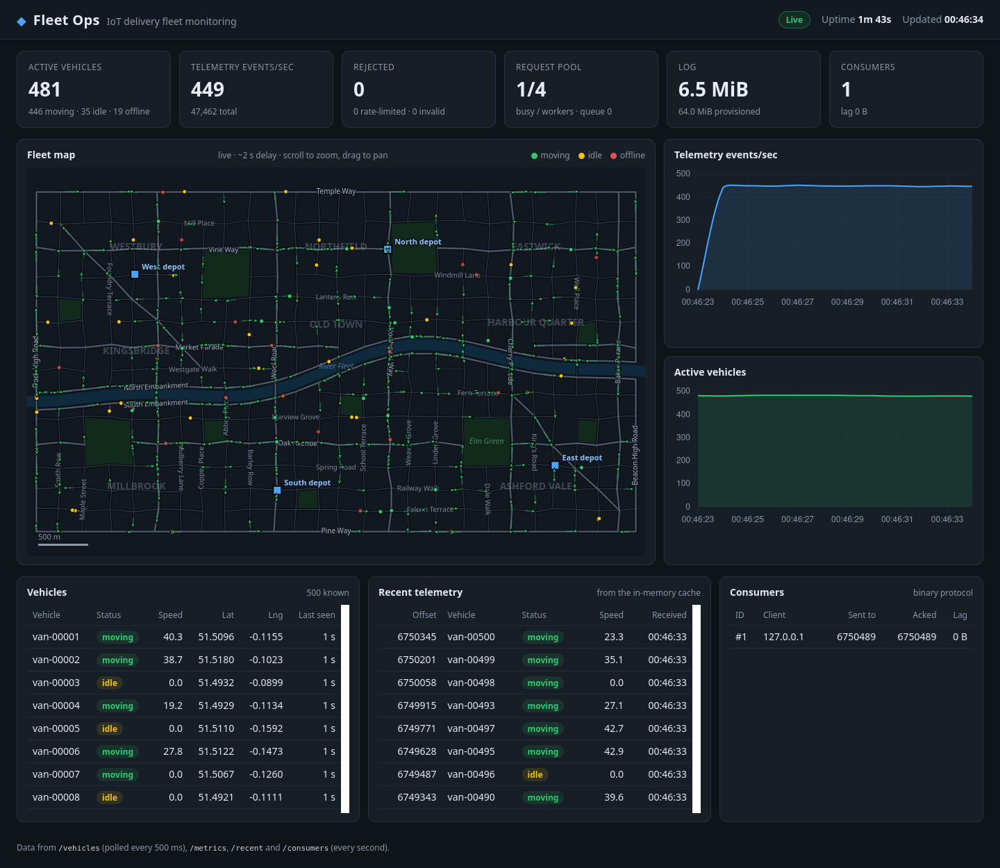
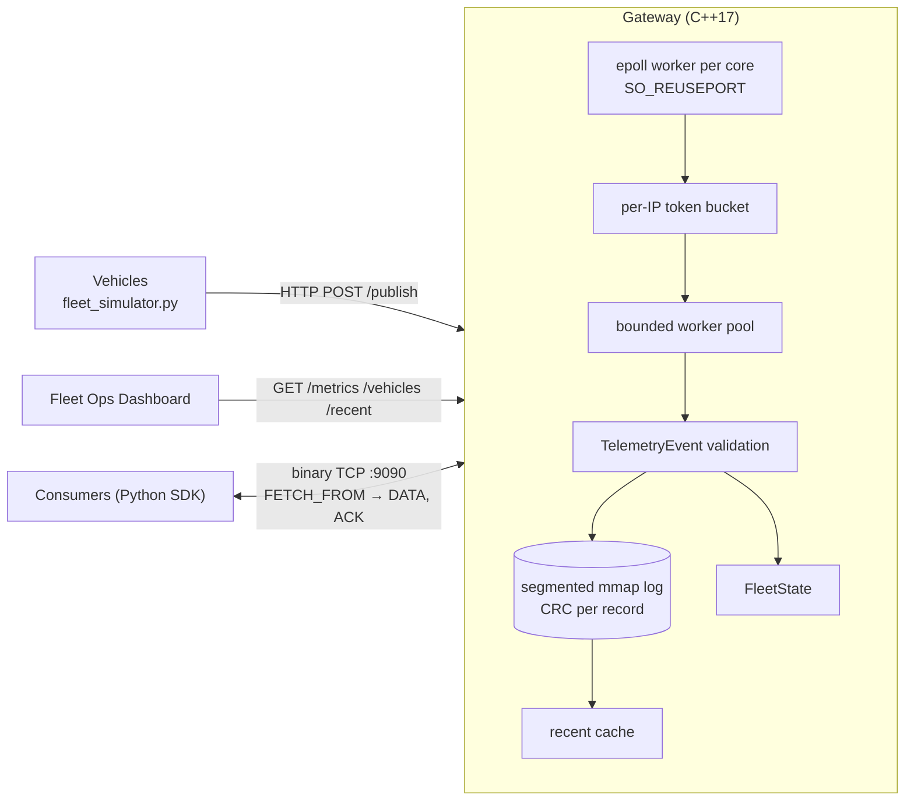

# IoT Delivery Fleet Monitoring

[](https://github.com/Tanmay11025/IoT-Delivery-Fleet-Monitoring/actions/workflows/ci.yml)


A live telemetry platform for delivery vans, built from scratch in C++17 on
Linux. Vans publish position and status over HTTP. The gateway validates each
report and appends it to a crash-safe log. A built-in dashboard shows the
fleet on a live map, and downstream services replay or stream every report
over a binary protocol, resuming exactly where they stopped after a crash.

In design terms, it is a small combination of **Nginx** (an epoll event
loop per core in front of a worker pool), **Kafka** (a segmented, offset-indexed
append-only log with replay and at-least-once consumers) and **Prometheus**
(a `/metrics` endpoint plus a dashboard).

## How to run

You need Linux (developed on Ubuntu), a C++17 compiler, CMake 3.16 or newer,
and Python 3. Nothing else: the Python examples use only the standard
library, and the dashboard is served by the gateway itself (its two charts
load Chart.js from a CDN; the map and tables work offline).

**1. Install the tools and build** (once):

```bash
sudo apt install build-essential cmake python3
git clone https://github.com/Tanmay11025/IoT-Delivery-Fleet-Monitoring.git
cd IoT-Delivery-Fleet-Monitoring
cmake -S . -B build && cmake --build build -j"$(nproc)"
```

**2. Start the gateway** (terminal 1):

```bash
./build/message_gateway --config config.demo.ini
```

It serves HTTP and the dashboard on port 8080 and the consumer protocol on
port 9090, and stores the log in `data/log`. `config.demo.ini` raises the
per-IP rate limit, because every simulated van publishes from the same
machine.

**3. Start the simulated fleet** (terminal 2):

```bash
python3 examples/fleet_simulator.py --vehicles 500
```

Vans drive the streets of a fictional 6 x 3.4 km city on delivery rounds from
four depots, reporting once a second. One simulator process handles up to
about 1,000 vans.

**4. Open the dashboard** at <http://localhost:8080/> (or run
`xdg-open http://localhost:8080/`).

- Vans glide along the streets about 2 seconds behind real time: green
  arrows are moving, yellow dots are stopped at a delivery or depot, and red
  vans have stopped reporting.
- **Scroll** over the map to zoom (25% per wheel notch), **drag** to pan,
  **double-click** to reset the view. Street names appear as you zoom in.
- Hover over a van to see its speed, position and last report.

**5. Optional extras** (terminal 3):

```bash
# A dispatch monitor that alerts on speeding (> 50 km/h) or silent vans and
# resumes from its offset file after a restart
python3 examples/fleet_consumer.py --speed-limit 50 --offset-file dispatch.offset

# Afterwards: where was one van, and when?
python3 examples/replay_vehicle.py --vehicle van-00003
```

**6. Stop** with **Ctrl+C** in each terminal. The gateway shuts down cleanly,
and on the next start it recovers everything already in `data/log`. Delete
that directory to start from an empty log.

**If something goes wrong:**

| Symptom | Fix |
| --- | --- |
| `Port 8080 is already in use by another process` | Another gateway is still running. Stop it (`pkill -f message_gateway`) and start again. |
| Simulator prints a growing `rate_limited` count | Start the gateway with `--config config.demo.ini`; `config.example.ini` keeps strict per-IP limits. |
| Dashboard changes do not appear | The gateway reads the dashboard files at startup: restart it, then hard-reload the page (Ctrl+Shift+R). |
| `No vehicles yet` on the map | The simulator is not running, or it points at a different port (`--http-port`). |

`config.example.ini` keeps the strict production-style defaults (10-token
bucket, 5 tokens/s per IP). Every setting can also be overridden with a CLI
flag (`./build/message_gateway --help` prints them).



<!-- To refresh: follow How to run above, then capture the browser window. -->

## Highlights

- **~77,000 validated telemetry events/s** at 1.03 ms P99
  (120-byte events, 100 connections, 4 pool threads, one laptop) ·
  [benchmark report](docs/results.md#6-sustained-throughput-benchmark)
- **50,000 concurrent clients** in the staged burst test, with every
  acknowledged write recovered after restart · [results](docs/results.md)
- **Acknowledged writes survive `kill -9`** mid-stream, verified by a chaos
  test that crashes the gateway while four publishers are sending
- **Consumers never skip a record.** They resume from a saved offset after
  either side crashes (at-least-once delivery, tested both ways)
- **A measured optimisation:** callgrind found a bit-at-a-time CRC32 inside
  the log lock. A table-driven version made 8 KiB publishes **3.2× faster**
  · [journal](docs/journal.md)

## Architecture



More detail: [architecture.md](docs/architecture.md) (lifecycle and
concurrency diagrams) · [protocol.md](docs/protocol.md) (HTTP API, telemetry
schema, binary frames byte by byte).

| Area | What is in the code | Where |
| --- | --- | --- |
| Operating systems | `epoll`, non-blocking sockets, `eventfd`, `mmap`/`msync`/`ftruncate`, signals | `src/network`, `src/storage` |
| Networking | TCP fragmentation handling, incremental HTTP parser, length-prefixed binary protocol, network byte order | `src/http`, `src/protocol` |
| Concurrency | thread pool + condition variable, `shared_mutex`, per-worker ownership with no locks on the socket path | `src/network/thread_pool.h`, `src/telemetry/fleet_state.cpp` |
| Data structures | token bucket, ring buffer, hash maps, binary search over the segment index | `src/security`, `src/storage` |
| Storage and reliability | append-only segments, CRC32, torn-tail recovery, offset replay, at-least-once consumers | `src/storage/mmap_log.cpp` |
| Testing | 51 C++ tests, 38 pytest integration/chaos tests, 13 Docker HTTP tests, `wrk` benchmarks, ASan/UBSan in CI | `tests/` |

## Python SDK

```bash
pip install -e python_sdk      # standard library only
```

```python
from gateway_client import GatewayClient

client = GatewayClient("127.0.0.1", http_port=8080, consumer_port=9090,
                       offset_file="dispatch.offset")

client.send_telemetry({"vehicle_id": "van-00482", "lat": 51.5074, "lng": -0.1278,
                       "speed": 32.5, "status": "moving", "timestamp": 1726310400})

def handle(message):                     # called once per record, in log order
    print(message.offset, message.json()["vehicle_id"])

client.subscribe_stream(handle)          # resumes from dispatch.offset if present
```

## Reliability guarantees, stated precisely

| Guarantee | Evidence |
| --- | --- |
| A `201` publish survives a crash of the gateway **process** (`kill -9`) | `tests/chaos/test_kill9.py` |
| SIGTERM drains in-flight requests, exits 0, loses nothing acknowledged | `tests/chaos/test_graceful_shutdown.py`, staged test (9/9 stages) |
| Torn or corrupt records at the log tail are detected (CRC32) and truncated on restart | `mmap_log_tests` |
| A consumer never skips a record after a consumer or gateway crash; it may see one twice | `tests/integration/test_consumer_reconnect.py` |

**Not guaranteed:** surviving power loss or a kernel crash. Records reach the
page cache, but they are not `fsync`'d one by one; segments are synced when
full and at shutdown. This is a deliberate throughput trade-off (see
[protocol.md §3](docs/protocol.md#3-durability-boundary)).

## Testing

```bash
ctest --test-dir build                       # 51 C++ unit tests
pip install pytest && python3 -m pytest     # 38 integration + chaos tests (starts real gateways)
bash scripts/run_http_integration_test.sh    # 13 raw-socket HTTP tests in Docker
python3 scripts/run_backend_tests.py         # staged 100 → 50,000 client burst test
tests/benchmarks/run_bench.sh                # wrk throughput matrix
```

CI runs the C++ and pytest suites in Release, again under
AddressSanitizer + UBSan, the chaos tests, and the Docker HTTP suite.

## Repository layout

```text
src/
  network/     TCPServer, EpollLoop, ConnectionManager, ThreadPool, consumer pump
  http/        HTTPParser, HttpResponse, Router, dashboard static files
  protocol/    binary consumer frame codec
  telemetry/   TelemetryEvent validation, FleetState
  storage/     MemoryMappedLog, CircularBuffer
  security/    TokenBucket, RateLimiter
  monitoring/  Prometheus metrics
dashboard/     Fleet Ops dashboard (HTML/CSS/vanilla JS + Chart.js)
python_sdk/    gateway_client package
examples/      fleet_simulator.py, fleet_consumer.py, replay_vehicle.py
tests/         C++ unit tests, integration/, chaos/, benchmarks/
docs/          architecture, protocol, performance results, journal, test reports
```

## Known limitations and future work

- **Security:** no TLS or authentication. The per-IP rate limiter is the only
  edge control, and its IP map is not yet bounded or expired.
- **Single node:** no replication, partitioning, or consumer groups. Multiple
  gateways would need shared rate-limit state and a partitioned log.
- **Delivery semantics:** at-least-once, not exactly-once, which would need
  the consumer's offset commit and side effects to be atomic.
- **Rollover stall:** a full segment is `msync`'d while appends wait, which
  shows up as P99 spikes with large bodies. The fix is to sync sealed
  segments in the background ([results §6.3](docs/results.md#63-interpretation)).
- **HTTP:** one request per connection (no keep-alive); chunked encoding is
  rejected.
- **Fleet features:** geofencing rules, route history queries by time (replay
  is by offset today), and multi-region fleets.

## Documentation

[architecture.md](docs/architecture.md) ·
[protocol.md](docs/protocol.md) ·
[journal.md](docs/journal.md) ·
[results.md](docs/results.md) (test results, load tests and benchmarks) ·
[tests.md](docs/tests.md) (staged load-test details) ·
[implementation.md](docs/implementation.md) ·
[project overview.md](docs/project%20overview.md)
