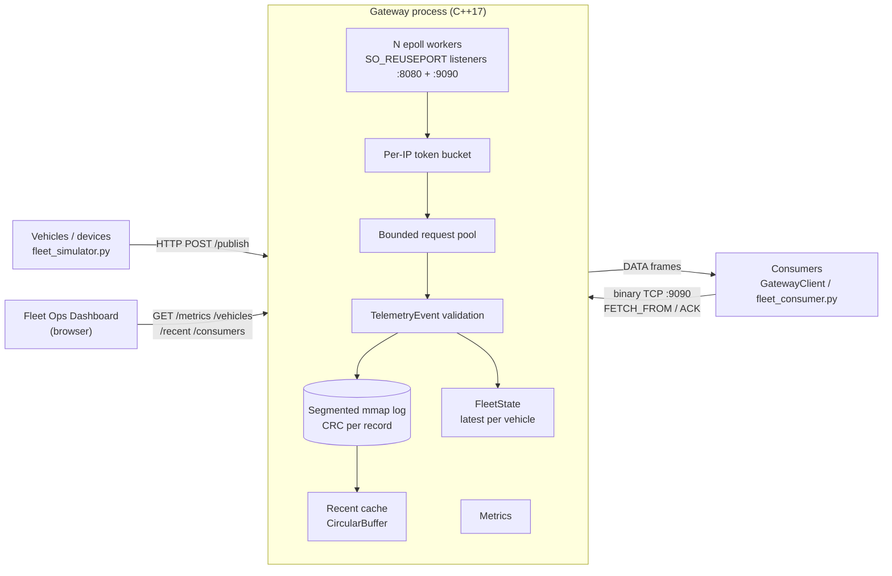
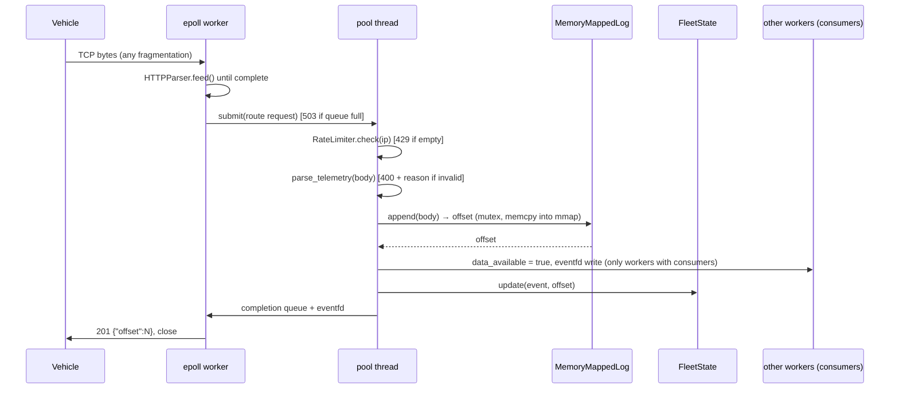
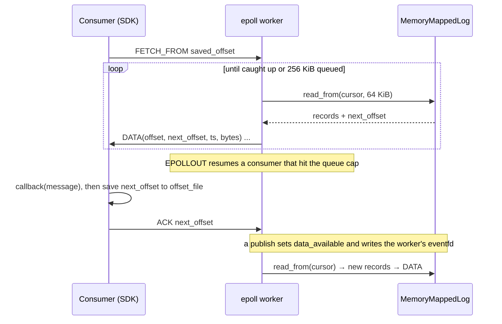

# Architecture

This document explains how the gateway is put together and why. Wire formats
are in [protocol.md](protocol.md); measured behaviour is in
[performance_results.md](performance_results.md) and [results.md](results.md).

## 1. System overview



The design is a single process, organised like an Nginx worker model (one
epoll loop per core) in front of a Kafka-style append-only log, with
Prometheus-style metrics. Each box maps to one class:

| Component | Class / file | Owns |
| --- | --- | --- |
| Listener + event loop | `TCPServer::worker_loop`, `EpollLoop` | sockets, readiness, per-worker `ConnectionManager` |
| HTTP framing | `HTTPParser`, `HttpResponse` | bytes ↔ requests, size limits |
| Dispatch | `Router` + `RateLimiter` | method/path → handler, 429 |
| Work execution | `ThreadPool` | bounded queue, graceful drain |
| Validation | `parse_telemetry` | the TelemetryEvent contract |
| Storage | `MemoryMappedLog` | segments, offsets, recovery, `read_from` |
| Hot reads | `CircularBuffer<Message>` | last N records for `/recent` and fleet rebuild |
| Fleet view | `FleetState` | latest event per vehicle, offline detection |
| Consumer protocol | `FrameDecoder`, `TCPServer::pump_consumer` | binary frames, replay, backpressure |

## 2. Publish lifecycle



Key decisions:

- **The epoll thread never blocks on application work.** It only parses and
  writes. Routing, validation and the log append run on the pool, and the
  result comes back through a per-worker completion queue plus `eventfd`, so
  every socket is still only touched by its owning worker.
- **Validation happens before the append**, so the log never contains
  records the rest of the system cannot interpret.
- **FleetState is derived, not authoritative.** It can be rebuilt from the
  log, which is what happens at startup (from the recovered recent cache).
  Updates are ordered by log offset, so two pool threads finishing out of
  order cannot move a vehicle backwards.

## 3. Consumer replay and live streaming



- **Finding an offset is a binary search plus arithmetic.** Offsets are global
  byte positions, so `read_from` finds the segment with `upper_bound` on each
  segment's first offset. The position inside the segment is
  `40 + (offset - first_offset)`. Every record read is checked for magic,
  offset and CRC.
- **Reads don't block writers.** `read_from` copies the segment index under
  the log mutex, then reads with `pread` outside it. Bytes below the log end
  never change in an append-only log, so this is safe.
- **No new cross-thread machinery.** Publishers wake consumer workers through
  the same `eventfd` the pool already uses for completions. A
  `data_available` flag means a burst of publishes causes one wake-up, not
  one per record.
- **Backpressure per consumer.** A slow consumer stops being refilled at about
  256 KiB queued and costs nothing else. Its position is just its cursor.
- **At-least-once delivery.** The client saves `next_offset` after its
  callback. A crash between the two causes one re-delivery, never a gap
  (`tests/integration/test_consumer_reconnect.py`).

## 4. Storage layout

```text
data/log/
  log-00000001.seg   [segment header 40 B][record][record]...[zero padding]
  log-00000002.seg   (first_offset = end of segment 1)

record = magic u32 | header size u32 | offset u64 | timestamp_ns u64 | length u32 | crc32 u32 | payload
```

- Segments are pre-sized with `ftruncate` and mapped `MAP_SHARED`. An append
  is a `memcpy` under a mutex.
- When a record does not fit, the active segment is `msync`'d, `fsync`'d and
  closed, and a new one is created. Records never span segments.
- On startup every segment is scanned. A torn or CRC-failing record at the
  tail of the newest segment is truncated, while corruption in a sealed
  segment stops startup. That is the right failure for data that was once
  synced.

## 5. Concurrency model

| Shared state | Writers | Readers | Protection |
| --- | --- | --- | --- |
| Socket / `Connection` | owning epoll worker | same worker | none needed (single owner) |
| Rate-limiter map | pool threads | pool threads | `shared_mutex` + per-bucket mutex |
| Log + recent cache | pool threads (append) | pool, consumers, metrics | `mutex` (index snapshot for reads) |
| FleetState | pool threads | `/vehicles`, `/metrics` | `shared_mutex` |
| Consumer registry | epoll workers | `/consumers`, `/metrics` | `mutex` |
| Worker list for wake-ups | epoll workers (start/exit) | pool threads (publish) | `mutex` |
| Counters | everyone | `/metrics` | `std::atomic` |

No code path holds two of these locks at once. The rate limiter releases
its map lock before taking a bucket lock, and `/metrics` reads each
component one after another. So there is no lock ordering to get wrong.

## 6. Deliberate limits

- One node: no replication, partitioning or consumer groups.
- No TLS or authentication. The rate limiter is the only edge protection, and
  its IP map is not bounded.
- One request per HTTP connection (no keep-alive or pipelining).
- Durability is "survives a process crash", not "survives power loss" (see
  protocol.md §3).
- The log grows forever (no retention), and FleetState is rebuilt only from
  the recent window.
